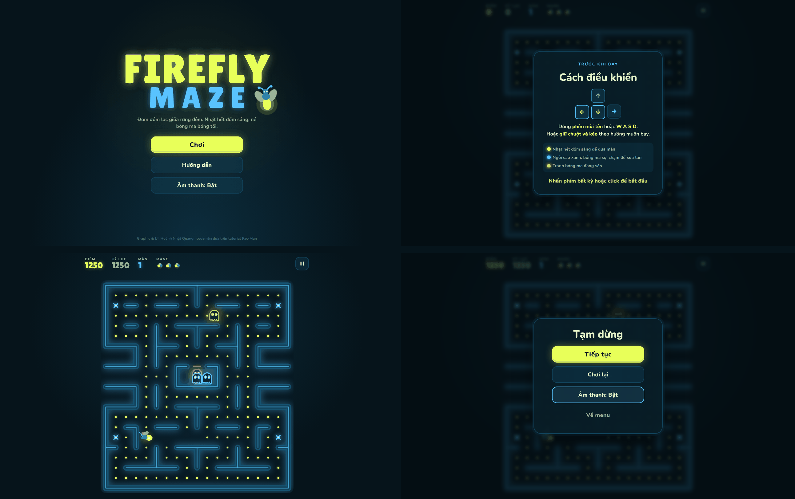
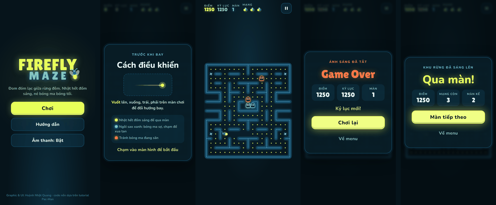

# Firefly Maze

Một con đom đóm lạc giữa rừng đêm, nhặt hết đốm sáng và né những bóng ma bóng tối. Game mê cung chạy trên trình duyệt, chơi được trên máy tính lẫn điện thoại.

**▶ Chơi ngay: [firefly-maze.vercel.app](https://firefly-maze.vercel.app)**





## Chơi thế nào

- **Bay:** phím mũi tên hoặc W A S D, hoặc giữ chuột và kéo theo hướng. Trên điện thoại: vuốt trên màn chơi.
- Bấm hướng sớm hoặc trễ một chút so với lối rẽ vẫn rẽ được, nên điều khiển mượt hơn.
- **Đốm sáng vàng:** +10 điểm. Nhặt hết để qua màn.
- **Ngôi sao xanh:** bóng ma sợ hãi trong vài giây, chạm vào để xua tan chúng (+200, +400, +800, +1600).
- **Tạm dừng:** P hoặc Esc.
- Mỗi màn mới, đom đóm và bóng ma nhanh hơn một chút.

## Chạy thử trên máy

Mở `index.html` bằng trình duyệt, hoặc chạy một server tĩnh:

```bash
npx serve .
```

## Thiết kế

- **Bảng màu "Lam đêm":** nền #06141B · tường #11425A · đom đóm #E8FF59 · điểm nhấn #59C3FF · chữ #E6F1F5 · 4 bóng ma #FF7A45 #FF5C8A #B98CFF #59C3FF
- **Font:** Lilita One (logo, chữ tiếng Anh, con số) + Nunito (toàn bộ chữ tiếng Việt). Font được nhúng sẵn trong thư mục `fonts/`.
- **Màn hình:** Bắt đầu · Cách điều khiển (tự đổi theo điện thoại/máy tính) · HUD · Tạm dừng · Game Over · Qua màn · Hướng dẫn. Ảnh chụp từng màn trong thư mục `design/`.
- Nhân vật, bóng ma, đốm sáng và mê cung được vẽ bằng Canvas dạng vector có hiệu ứng phát sáng, nên sắc nét ở mọi kích thước màn hình.

## Ghi công

- Ý tưởng, graphic và UI: **Huỳnh Nhật Quang**
- Gameplay dựa trên một tutorial Pac-Man bằng JavaScript (2023), đã viết lại toàn bộ: bản đồ mới, canvas co giãn theo màn hình, điều khiển vuốt/kéo chuột, hỗ trợ rẽ sớm/trễ, vật phẩm sức mạnh, hệ thống màn chơi.
- Firefly Maze không liên quan đến Pac-Man™ của Bandai Namco. Tên, nhân vật và hình ảnh đều là thiết kế riêng.

## Công nghệ

HTML · CSS · JavaScript thuần (Canvas 2D, Web Audio). Không dùng thư viện, không cần build.
